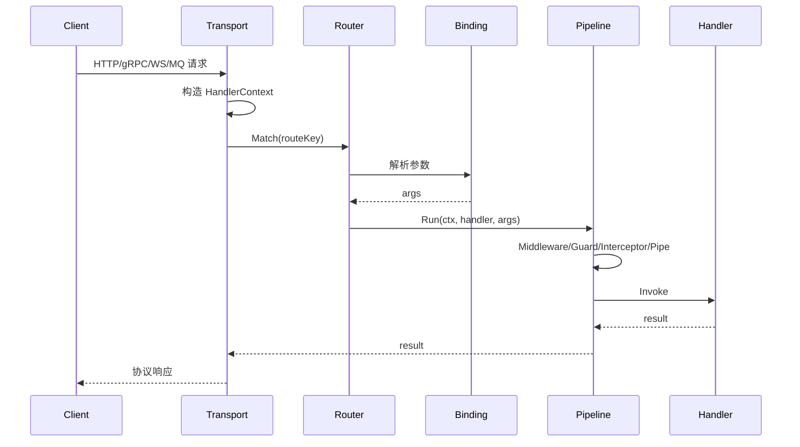

`lania-g` 的核心价值在于**把声明与执行拆开**：

```text
Declare（Controller）→ Registry → Compiler → Runtime → Handler
```

## 1. 声明阶段

控制器实现协议包的 `Declare(*Routes)`，声明被写入 Registry。这条链路完全由模块树驱动：
`Application` 遍历根模块的所有模块，对每个实现了 `module.Declarer` 的控制器调用 `Declare`。

```go
func (c *UserController) Declare(r *httpadapter.Routes) {
	r.Prefix("/users").
		UseGuards(authGuard).
		Get("/:id", c.Get)
}
```

此时还没有任何反射调用，也没有生成 handler。
每个协议模块在声明前会 `ClearDecl`，因此热重载可以安全地重复声明。

## 2. 编译阶段

`app.Run()` 内部先执行声明阶段，然后触发编译（也可以直接调用 `app.Diagnostics()` 观察）：

1. **扫描** Registry 中的声明（routes、AOP、bindings、integrations）
2. **校验** 冲突与非法声明（例如同一 routeKey 重复声明）
3. **推导** handler 的 owner 容器、参数计划（ParamPlans）
4. **产物** 一份 `CompiledApp`，可安装到 Runtime

```go
if err := app.Run(); err != nil {
	panic(err)
}

diag := app.Diagnostics()
_ = diag
```

常见编译错误：

| 错误 | 含义 |
|------|------|
| `duplicate route declaration` | 同一个 routeKey 被声明两次 |
| `module owner not found` | handler 所属 receiver 不在模块槽位 |
| `binding not supported for protocol` | 参数类型命中了别的协议的 binding |
| `grpc stream method ... should return only error` | 流式方法签名不合法 |

## 3. 安装阶段

编译产物通过 `compiled.Install(rt)` 写入 Runtime：

- Router：注册 routeKey → Handler
- BindingRegistry：注册各协议的参数解析器
- RouteContainers：每个路由对应的模块容器

## 4. 执行阶段

```text
请求 → Protocol Transport → HandlerContext
     → Router.Match(routeKey)
     → Binding.Resolve(args)
     → AOP Pipeline（Middleware → Guard → Interceptor → Pipe）
     → Handler.Invoke
     → 协议响应编码
```

统一上下文 `runtime.HandlerContext` 承载：

| 字段 | 含义 |
|------|------|
| `Request.Method/Path` | 路由信息（WS 里分别是 event/namespace） |
| `Request.Headers/HeadersMulti` | 请求头 |
| `Request.Body/BodyBytes` | 请求体 |
| `Request.Query/Params` | 查询参数与路径参数 |
| `Request.Raw` | 原始请求对象（如 `*http.Request`、grpc stream） |
| `Render.Raw` | 响应对象 |
| `Container` | 当前请求的容器 |

## 5. 为什么这样设计

| 问题 | 传统做法 | lania-g |
|------|----------|---------|
| 新增协议 | 复制整套路由/参数/AOP 逻辑 | 只写一个 Adapter + Plugin |
| 启动期发现问题 | 等第一个请求报错 | 编译期诊断 |
| 跨协议复用 | 各写一套 | 共用 Runtime 执行链 |

## 6. 一个请求的完整时序


